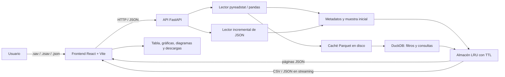

# SAV Studio

[](https://github.com/HUEJK24/sav-studio/releases)
[](LICENSE)
[](#prop%C3%B3sito-y-licencia)

**Explora, filtra y visualiza datos de SPSS desde el navegador.**

SAV Studio es una herramienta web gratuita y de código abierto para analizar archivos de encuestas `.sav` y `.zsav` sin instalar IBM SPSS. También acepta archivos JSON con una lista de registros. Presenta los datos en una tabla interactiva, conserva metadatos de SPSS y permite crear gráficas, diagramas y exportaciones filtradas CSV/JSON.

El proyecto fue creado con fines de estudio académico. Se ejecuta localmente: tus archivos se procesan en el backend de la aplicación y no se envían a un servicio de análisis externo.

**Versión documentada:** `1.0.0` · **Licencia:** MIT · **Interfaz:** español

> El repositorio no incluye datasets `.sav` ni datos de usuarios. Carga tus propios archivos después de iniciar la aplicación. Los archivos de datos existentes se conservan en tu equipo y están excluidos de Git.

## Características principales

- **Importación SPSS y JSON:** carga `.sav`, `.zsav` y JSON en formato de lista de objetos.
- **Metadatos SPSS:** etiquetas de variables y valores, medidas, formatos, valores perdidos y estadísticas disponibles.
- **Exploración eficiente:** tabla paginada, filtros por columna y reglas avanzadas combinables.
- **Visualización:** ocho tipos de gráfica, dashboard configurable y diccionario de variables.
- **Diagramas:** flujo del análisis, mapa de variables, diagramas entidad-relación y flujos editables.
- **Exportación:** descarga de los datos filtrados a CSV o JSON, con porcentaje y filas procesadas.
- **Datos grandes:** muestra inicial, paginación en el servidor y caché local DuckDB/Parquet para datasets SPSS grandes.

### Captura de pantalla

Inicia la aplicación y carga un archivo `.sav`, `.zsav` o `.json` para ver el dashboard interactivo.

## Contenido

- [Características principales](#caracter%C3%ADsticas-principales)
- [Propósito y licencia](#prop%C3%B3sito-y-licencia)
- [Versionado](#versionado)
- [Objetivos y alcance](#objetivos-y-alcance)
- [Funcionalidades](#funcionalidades)
- [Arquitectura](#arquitectura)
- [Tecnologías y versiones](#tecnologías-y-versiones)
- [Estructura del proyecto](#estructura-del-proyecto)
- [Flujo de datos](#flujo-de-datos)
- [Rendimiento y manejo de archivos grandes](#rendimiento-y-manejo-de-archivos-grandes)
- [Metodología y criterios de implementación](#metodología-y-criterios-de-implementación)
- [Requisitos e instalación](#requisitos-e-instalación)
- [Ejecución en desarrollo](#ejecución-en-desarrollo)
- [Compilación y despliegue](#compilación-y-despliegue)
- [API HTTP](#api-http)
- [Configuración](#configuración)
- [Pruebas y validación](#pruebas-y-validación)
- [Decisiones, limitaciones y seguridad](#decisiones-limitaciones-y-seguridad)

## Propósito y licencia

SAV Studio se desarrolló como proyecto de estudio académico y se ofrece gratuitamente bajo los términos de la licencia [MIT](LICENSE). La licencia permite usar, modificar y redistribuir el software sujeto a sus condiciones; el proyecto se proporciona sin garantía y no incluye soporte ni un servicio alojado.

La licencia cubre el código de este proyecto. Los archivos de datos SPSS que se usen con la aplicación no se incluyen en el repositorio y pueden estar sujetos a licencias, restricciones de privacidad o derechos de terceros independientes.

## Versionado

La versión documentada actual es **`1.0.0`**, consistente con los manifiestos del proyecto. SAV Studio usa **Versionado Semántico (SemVer)** en formato `MAJOR.MINOR.PATCH`:

- **MAJOR:** cambios incompatibles en la API o el comportamiento esperado.
- **MINOR:** nuevas funcionalidades compatibles con versiones anteriores.
- **PATCH:** correcciones compatibles con versiones anteriores.

Al preparar una versión nueva, actualiza este número junto con los campos `version` de `package.json`, `frontend/package.json` y `backend/app/main.py`; registra el resumen de cambios y crea una etiqueta Git con prefijo `v` (por ejemplo, `v1.0.1`). Esta sección documenta el criterio de versionado; no implica que exista una publicación o etiqueta de release para cada versión.

## Objetivos y alcance

El proyecto cubre el ciclo de exploración de una encuesta:

1. Abrir un archivo SPSS o un JSON compatible.
2. Consultar variables, etiquetas, estadísticas y registros.
3. Explorar los datos en una tabla y aplicar filtros.
4. Construir gráficas y diagramas según las variables seleccionadas.
5. Descargar el subconjunto de datos que corresponde a la vista o filtros activos.

El alcance actual es de una aplicación de una sola página (SPA) con un backend HTTP. No incluye cuentas de usuario, permisos, almacenamiento permanente de datasets ni una base de datos de negocio.

## Funcionalidades

### Datos y metadatos

- Carga de `.sav` y `.zsav` usando `pyreadstat`; no requiere SPSS instalado.
- Carga de JSON cuyo contenido sea una lista de objetos, por ejemplo, un archivo exportado anteriormente desde SAV Studio.
- Lectura de metadatos SPSS: nombres y etiquetas de variables, etiquetas de valores, medidas, formato, valores perdidos y estadísticas descriptivas disponibles.
- Conversión de valores nulos, fechas y tipos numéricos a valores serializables para la API y las descargas.

### Tabla y filtros

- Tabla virtualizada con AG Grid Community.
- Filtros de columna para texto, números y categorías.
- Filtros avanzados combinables en modo `Y` o `O`: igualdad, contiene, empieza por, comparaciones numéricas, intervalo, vacío/no vacío y listas.
- Paginación de 100 registros por vista; la API limita cada solicitud de página a 500 filas.
- Los filtros se aplican sobre el dataset completo para archivos que se consultan en modo paginado.

### Análisis, diagramas y exportación

- Dashboard con ocho tipos de gráfica: barras, barras horizontales, apiladas, líneas, área, dispersión, histograma y caja.
- Selección de variables para ejes, agrupación y agregación.
- Diccionario de variables con metadatos y estadísticas.
- Diagramas automáticos de flujo de análisis y mapa de variables; diagramas manuales tipo entidad-relación y casos de uso/flujo.
- Exportación filtrada a CSV o JSON, con barra de progreso y número de filas procesadas.
- Exportación de diagramas a Mermaid, JSON, SVG, PNG o PDF, según el modo y formato disponibles en la interfaz.

## Arquitectura

La solución utiliza una arquitectura cliente-servidor separada en dos procesos: una SPA React y una API REST FastAPI. El frontend solicita datos por JSON; las descargas grandes se transmiten progresivamente.



### Responsabilidades por capa

| Capa | Responsabilidades |
| --- | --- |
| Interfaz React | Estado de la sesión, carga de archivos, filtros, navegación entre vistas, visualizaciones, progreso y descargas. |
| Cliente HTTP (`frontend/src/api.js`) | Solicitudes a la API, transferencia de carga, paginación, exportación y consulta de progreso. |
| API FastAPI (`backend/app/main.py`) | Validación de solicitudes, ciclo de vida de datasets, endpoints, coordinación de lectores, filtros y exportadores. |
| Lectura (`backend/app/sav_reader.py`) | Lectura SPSS/JSON, normalización, etiquetas, cálculo de metadatos, lectura por bloques y consultas a la caché. |
| Filtros y exportación | Predicados compatibles con ambos lados, serialización CSV/JSON y emisión por bloques. |
| Almacén (`backend/app/store.py`) | Datasets activos en memoria, política LRU/TTL y limpieza de archivos temporales. |

La comunicación local usa Vite como servidor de desarrollo y proxy de `/api` hacia FastAPI. En despliegue, el servidor web o CDN sirve `frontend/dist` y debe encaminar `/api` al backend.

## Tecnologías y versiones

Las versiones de frontend que se muestran son las resueltas en `frontend/package-lock.json`. Para Python, `requirements.txt` declara rangos compatibles (no fija todas las dependencias); la columna indica las versiones instaladas en el entorno de desarrollo cuando se redactó esta documentación.

### Frontend y herramientas JavaScript

| Tecnología | Versión | Uso |
| --- | --- | --- |
| Node.js | 26.5.0 (entorno verificado) | Runtime de las herramientas frontend. |
| npm | 11.17.0 (entorno verificado) | Instalación y scripts. |
| React / React DOM | 18.3.1 | Interfaz basada en componentes y estado. |
| Vite | 5.4.11 | Servidor de desarrollo y compilación. |
| `@vitejs/plugin-react` | 4.3.4 | Integración de React con Vite. |
| AG Grid Community / React | 32.3.3 | Tabla interactiva. |
| `plotly.js-cartesian-dist-min` | 2.35.2 | Gráficas estadísticas. |
| `@xyflow/react` | 12.12.1 | Editor y visualización de diagramas. |
| Mermaid | 12.3.0 | Generación de diagramas automáticos. |
| PapaParse | 5.4.1 | Serialización de CSV. |
| jsPDF | 4.2.1 | Exportación PDF de diagramas. |
| concurrently | 9.2.5 | Arranque coordinado de frontend y backend en desarrollo. |

### Backend y pruebas

| Tecnología | Restricción del manifiesto | Versión instalada verificada | Uso |
| --- | --- | --- | --- |
| Python | 3.10+ recomendado | 3.14.6 | Runtime del backend. |
| FastAPI | `>=0.115,<1` | 0.162.0 | API HTTP y validación de solicitudes. |
| Uvicorn | `>=0.34,<1` | 0.54.0 | Servidor ASGI. |
| pyreadstat | `>=1.3.7,<2` | 1.3.7 | Lectura y metadatos de archivos SPSS. |
| pandas | `>=2.2` | 3.1.1 | Marcos de datos, estadísticas y conversión. |
| DuckDB | `>=1.2,<2` | 1.5.6 | Consultas de la caché local. |
| python-multipart | `>=0.0.20` | 0.0.33 | Recepción de archivos multipart. |
| pytest | `>=8.3` (desarrollo) | 9.2.0 | Pruebas automatizadas. |
| httpx | `>=0.28` (desarrollo) | 0.28.1 | Cliente de pruebas para FastAPI. |

Los valores de “versión instalada verificada” describen el entorno utilizado; no son todos bloqueos de versión para otros entornos. Para una instalación repetible, conserva los archivos `package-lock.json` y crea el entorno virtual Python con los requisitos del proyecto.

## Estructura del proyecto

```text
backend/
  app/
    main.py          API FastAPI, subida, estado y endpoints
    sav_reader.py    Lectores SPSS/JSON, metadatos, páginas y caché
    filters.py       Reglas y predicados de filtrado
    exporters.py     Exportación CSV/JSON por bloques
    store.py         Almacén LRU con TTL y limpieza de temporales
    config.py        Límites, caché y orígenes CORS
    utils.py         Utilidades de archivos y rutas
  tests/
    test_api.py      Pruebas de API, lectores, filtros y exportación
  requirements.txt
  requirements-dev.txt
frontend/
  src/
    App.jsx              Aplicación y estado de la sesión
    api.js               Cliente HTTP y gestión de respuestas
    components/          Tabla, carga, filtros, gráficas y diagramas
    lib/                 Exportación, filtros, gráficas y diagramas
    styles.css           Estilos de la interfaz
  index.html
  vite.config.js
package.json             Scripts coordinadores de la raíz
package-lock.json        Resolución de dependencias de la raíz
README.md
LICENSE
```

## Flujo de datos

1. **Carga:** `UploadPanel` envía el archivo como `multipart/form-data` a `POST /api/datasets`. La interfaz informa el progreso de transferencia; después, el backend identifica el formato y construye los metadatos.
2. **Lectura inicial:** para conjuntos grandes se conserva una muestra inicial, limitada por filas y celdas, para que la interfaz pueda abrirse sin cargar todo el dataset en memoria.
3. **Consulta:** la interfaz solicita páginas y metadatos. Cuando hay caché local disponible, DuckDB consulta solo las columnas necesarias para filtros compatibles; otros casos usan el recorrido de respaldo en el backend.
4. **Visualización:** la tabla, los KPI, las gráficas y el diccionario se actualizan con los datos y filtros activos. En datasets paginados, los resultados tabulares y filtros se resuelven contra el archivo completo, no solo contra la muestra inicial.
5. **Exportación:** la interfaz genera por lotes los archivos locales, o consume la respuesta en streaming para conjuntos paginados. El progreso comunica filas examinadas/procesadas; al completarse, se habilita la descarga.
6. **Cierre y expiración:** al cerrar, reemplazar o expirar un dataset, el almacén elimina sus archivos temporales asociados.

## Rendimiento y manejo de archivos grandes

- Los límites `MAX_ROWS` y `MAX_CELLS` acotan la muestra en memoria. Si el dataset excede la muestra, la tabla continúa disponible mediante paginación del servidor.
- Para un `.sav` ancho o grande, una tarea en segundo plano lee bloques (por defecto, 10,000 registros) y prepara archivos Parquet comprimidos con Zstandard. DuckDB consulta esta caché para acelerar páginas y filtros seleccionados.
- El tamaño del lote de construcción de caché, la compresión y el tamaño de row group se pueden configurar; la preparación inicial requiere leer el archivo completo y disponer de espacio temporal en disco.
- Los JSON se recorren incrementalmente al construir metadatos, páginas y exportaciones; un JSON truncado puede requerir recorrer desde el inicio para resolver una página.
- Las exportaciones pequeñas se serializan en lotes de 500 filas para permitir que la interfaz se actualice mientras trabaja. Las exportaciones del servidor se generan en streaming y publican el avance a través de un endpoint de estado.
- El porcentaje de una exportación representa filas examinadas respecto al total del archivo. Si hay filtros, las filas procesadas pueden ser más que las filas que finalmente se escriben.

## Metodología y criterios de implementación

El código refleja una construcción incremental por capacidades, con módulos separados por responsabilidad y validación automatizada del backend:

1. **Fundación:** lector SPSS/JSON, metadatos, carga y API.
2. **Exploración:** tabla paginada, filtros y visualización.
3. **Escalabilidad:** muestra inicial, lectura por bloques, caché Parquet/DuckDB y exportación incremental.
4. **Comunicación de estado:** progreso de carga/indexación/exportación y mensajes de error.
5. **Validación:** pruebas de API y lógica del backend, además de compilación de producción del frontend.

Principios de diseño usados:

- **Separación de responsabilidades:** presentación, acceso HTTP, reglas, lectura, almacenamiento y exportación tienen módulos distintos.
- **Contrato HTTP explícito:** el frontend intercambia JSON para metadatos y consultas; los archivos se suben como multipart y las exportaciones usan respuestas de descarga.
- **Procesamiento por páginas y streaming:** evitar transferir o materializar en memoria todo un archivo cuando no es necesario.
- **Compatibilidad de filtros:** reglas con una representación común y aplicación en el backend; las consultas aceleradas se usan cuando la operación es compatible.
- **Tolerancia de fallos visible:** la API devuelve errores HTTP y la interfaz comunica fallos de carga, consulta o exportación; no presenta una descarga fallida como exitosa.
- **Validación dirigida:** pruebas del backend cubren rutas y comportamientos clave; el build comprueba la integración de módulos del frontend.

No se declara un proceso formal Scrum, Kanban o TDD porque no está definido por los artefactos del repositorio. La metodología anterior describe las decisiones observables en la implementación, no una certificación ni un registro de ceremonias del equipo.

## Requisitos e instalación

Requisitos recomendados:

- Python 3.10 o superior.
- Node.js 18 o superior y npm.
- Windows PowerShell para los scripts de desarrollo incluidos.
- Espacio temporal en disco suficiente para el archivo cargado y, en `.sav` grandes, la caché local.
- Navegador moderno (Chrome, Edge, Firefox o Safari).

Desde la raíz del proyecto:

```powershell
# Dependencias de coordinación de la raíz
npm install

# Backend
cd backend
python -m venv .venv
.\.venv\Scripts\Activate.ps1
pip install -r requirements.txt
pip install -r requirements-dev.txt

# Frontend
cd ..\frontend
npm ci
```

También se puede usar `npm run install:all` desde la raíz para instalar las dependencias de Node y los requisitos de ejecución del backend. Ese script no instala los requisitos de desarrollo de pruebas.

## Ejecución en desarrollo

Desde la raíz del proyecto:

```powershell
npm run dev
```

El comando inicia FastAPI en `http://127.0.0.1:8000` y Vite en `http://127.0.0.1:5173`. El proxy de Vite reenvía `/api` al backend. Presiona `Ctrl+C` para detener ambos procesos.

Para comprobar la conexión del backend:

```powershell
curl.exe http://127.0.0.1:8000/api/health
```

El repositorio no incluye archivos de datos de ejemplo. Para probar la aplicación, carga un archivo propio en formato `.sav`, `.zsav` o JSON compatible.

## Compilación y despliegue

```powershell
npm run build
```

El comando genera los archivos estáticos en `frontend/dist`. Para desplegar:

1. Servir `frontend/dist` desde un servidor web o CDN.
2. Configurar el proxy de `/api` hacia la instancia FastAPI.
3. Definir explícitamente `CORS_ORIGINS` con los orígenes reales del frontend.
4. Proteger el acceso al backend con controles apropiados para el entorno.
5. Configurar permisos, capacidad y política de limpieza del directorio temporal.

El backend no sirve el frontend ni incluye configuración de despliegue productivo, TLS, autenticación, persistencia o escalado horizontal.

## API HTTP

La documentación interactiva de FastAPI está disponible en `/docs` y el esquema OpenAPI en `/openapi.json` mientras el backend está en ejecución.

| Método | Ruta | Descripción |
| --- | --- | --- |
| `GET` | `/api/health` | Estado del servicio y versión de pyreadstat. |
| `POST` | `/api/datasets` | Sube `.sav`, `.zsav` o JSON de filas en el campo multipart `file`. |
| `GET` | `/api/datasets/{id}` | Metadatos, variables y filas disponibles del dataset. |
| `GET` | `/api/datasets/{id}/status` | Estado y progreso de construcción de la caché de datos grandes. |
| `GET` | `/api/datasets/{id}/rows` | Obtiene una página con `offset` y `limit` (máximo 500). |
| `POST` | `/api/datasets/{id}/query` | Aplica `rules` y `matchMode`; acepta también `offset` y `limit`, y responde con el total filtrado. |
| `POST` | `/api/datasets/{id}/export` | Genera CSV o JSON con `format`, `rules` y `matchMode`; el cuerpo se transmite por streaming. |
| `GET` | `/api/exports/{id}/status` | Consulta progreso, filas examinadas, total y error de una exportación. El ID se recibe en `X-Export-Progress-Id`. |
| `POST` | `/api/datasets/{id}/reload` | Reprocesa el archivo original conservando el ID del dataset. |
| `DELETE` | `/api/datasets/{id}` | Cierra el dataset y elimina sus archivos temporales asociados. |

Los datasets viven en la sesión del proceso backend y usan identificadores opacos. Reiniciar el backend elimina su estado en memoria.

## Configuración

Variables de entorno del backend:

| Variable | Valor predeterminado | Descripción |
| --- | --- | --- |
| `MAX_UPLOAD_MB` | `5120` | Tamaño máximo de archivo recibido (5 GiB nominales). |
| `MAX_ROWS` | `200000` | Límite de filas para la muestra inicial. |
| `MAX_CELLS` | `50000` | Límite de celdas para acotar la muestra inicial. |
| `MAX_DATASETS` | `2` | Número máximo de datasets simultáneos en el almacén. |
| `MAX_FILTER_MATCHES` | `10000000` | Máximo de índices conservados en el recorrido de respaldo de filtros. |
| `DATASET_TTL_SECONDS` | `7200` | Tiempo de vida de un dataset sin actividad. |
| `CACHE_CHUNK_ROWS` | `10000` | Filas por bloque al crear la caché SPSS. |
| `CACHE_COMPRESSION` | `zstd` | Compresión de la caché Parquet. |
| `CACHE_ROW_GROUP_SIZE` | `122880` | Tamaño objetivo de los row groups Parquet. |
| `FILTER_CACHE_ENTRIES` | `8` | Cantidad de resultados de filtros retenidos por dataset. |
| `CORS_ORIGINS` | `http://localhost:5173,http://127.0.0.1:5173` | Orígenes web permitidos separados por coma. |

## Pruebas y validación

Desde la raíz:

```powershell
npm test
npm run build
```

O solo las pruebas del backend:

```powershell
cd backend
.\.venv\Scripts\python.exe -m pytest -q
```

Las pruebas existentes verifican estado de salud, carga y metadatos, lectura y paginación, filtros, caché, consultas y exportaciones. El número de pruebas puede cambiar conforme evolucione el proyecto; se debe usar el resultado del comando como referencia vigente, no un total fijo.

## Decisiones, limitaciones y seguridad

- **Almacenamiento temporal y memoria:** el almacén usa LRU y TTL, y admite un número limitado de datasets. Al expirar, cerrar o reemplazar un archivo, los temporales se eliminan. No existe almacenamiento permanente.
- **Caché SPSS:** preparar la caché requiere una lectura completa inicial y espacio adicional en disco. Si falla, la aplicación puede recurrir a la lectura del archivo original para las funciones que lo permiten.
- **Consultas JSON grandes:** la lectura por páginas puede recorrer el JSON desde el principio; filtros y exportaciones sobre un archivo grande pueden tardar, aunque informen el progreso.
- **AG Grid:** el filtro Set de AG Grid pertenece a Enterprise. Para usar la edición Community se implementó un filtro propio de categorías con búsqueda, contador y opciones para seleccionar o limpiar.
- **Autenticación:** no hay autenticación, autorización, aislamiento por usuario ni cuotas. No se debe exponer el servicio directamente a Internet o a usuarios no confiables sin añadir esos controles.
- **Validación de archivos:** los formatos admitidos son `.sav`, `.zsav` y JSON con una lista de objetos. No se admiten `.por`, `.dta` ni `.xlsx`.
- **Diagramas:** los diagramas editables se guardan en `localStorage` del navegador y no se sincronizan entre equipos. El modelo entidad-relación es heurístico porque un archivo SPSS representa una tabla plana, no un esquema relacional.
- **Bundle frontend:** Plotly, Mermaid y las herramientas de diagramas producen paquetes grandes; la carga diferida de vistas reduce el trabajo inicial, pero el tamaño final debe considerarse en despliegues con ancho de banda limitado.
- **Persistencia y despliegue:** no hay base de datos de negocio, autenticación ni configuración completa para producción. La caché DuckDB/Parquet es auxiliar y temporal, no sustituye un almacén persistente de datasets.
